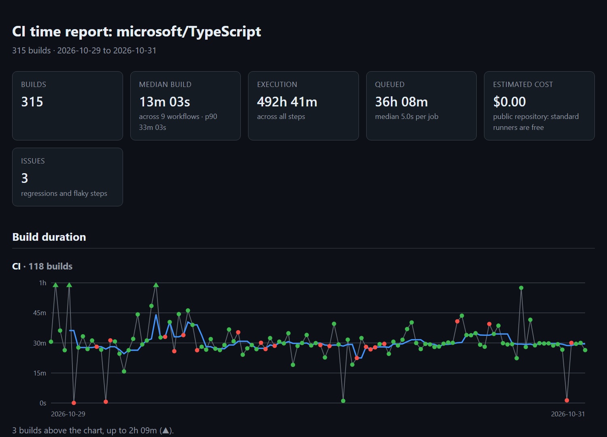

# ci-time-tracker

[](https://github.com/0xWhisp/ci-time-tracker/actions/workflows/ci.yml)
[](https://pypi.org/project/ci-time-tracker/)

Find where your CI time and money go. ci-time-tracker reads your GitHub Actions
history and reports the steps that cost the most, the ones that are flaky, and
the ones that got slower, with the commit where it started. It also recommends
changes to your workflows, backed by what your runs actually did. Its GitHub
Action comments on each pull request with how it changes CI time and cost.

```bash
pip install ci-time-tracker
ci-time-tracker --github owner/repo --last 300 --format html --output report.html
```

[](https://0xwhisp.github.io/ci-time-tracker/example-report.html)

**[See the full example report](https://0xwhisp.github.io/ci-time-tracker/example-report.html)**
for the last 300 runs of microsoft/TypeScript: three flaky steps, and
recommendations with up to 135 hours of runner time at stake, such as running
the Windows legs of three jobs only after merging, since in 87 builds they
never failed when Linux passed.

Set `GITHUB_TOKEN` first (with the GitHub CLI: `export GITHUB_TOKEN=$(gh auth token)`):
each run costs a request, and without a token GitHub allows 60 an hour.

## Features

- **History from the API**: Reads workflow runs, jobs and steps straight from
  the GitHub Actions API, cached locally so later runs take seconds
- **Flaky Detection**: Flag steps that both failed and passed on the same commit,
  including runs that only passed on a re-run
- **Regression Detection**: Flag steps whose duration jumped and stayed up, well
  beyond their usual variation, and name the commit where it started
- **Recommendations**: Dependency caching, cancelling superseded pull request
  runs, and matrix legs that never catch anything, each with the time at stake
- **Cost and Time**: Rank steps by the time they consume, estimate cost per runner
  at GitHub's list prices, and separate queue time from execution time
- **Pull Request Comments**: A GitHub Action that tells each pull request how it
  changes CI time and cost, and whether its failures are in known flaky steps
- **Output Formats**: A self-contained HTML report, Markdown for
  `$GITHUB_STEP_SUMMARY`, text, or JSON for dashboards; `--fail-on` gates
- **Config and Log Analysis**: Also parses GitHub Actions, GitLab CI and
  CircleCI configurations and build logs, for providers without API support yet

## Installation

Requires Python 3.10+.

```bash
pip install ci-time-tracker
```

Or from source:

```bash
git clone https://github.com/0xWhisp/ci-time-tracker.git
cd ci-time-tracker
pip install -e .
```

## Usage

### Config Analysis Mode

Analyze pipeline configuration files to understand structure and estimated runtimes:

```bash
# Analyze GitHub Actions workflow
ci-time-tracker --config .github/workflows/ci.yml

# Analyze with runtime estimates
ci-time-tracker --config .gitlab-ci.yml --estimates estimates.json

# Output as JSON
ci-time-tracker --config .circleci/config.yml --format json

# Save output to file
ci-time-tracker --config .github/workflows/ci.yml --output report.txt
```

**Estimates File Format** (`estimates.json`):
```json
{
  "Checkout": 5.0,
  "Build": 120.0,
  "Test": 300.0,
  "Deploy": 60.0
}
```

### GitHub Actions API Mode

Analyze recent workflow runs straight from the GitHub Actions API, with no log
files to collect. Timings come from the API, so nothing depends on parsing
runner log text:

```bash
# Last 50 runs of every workflow in the repository
ci-time-tracker --github acme/web

# Last 200 runs of a single workflow on main
ci-time-tracker --github acme/web --workflow ci.yml --branch main --last 200

# Every run of the last 30 days (also 12h, 2w, or a date: 2026-10-01)
ci-time-tracker --github acme/web --since 30d

# JSON for a dashboard
ci-time-tracker --github acme/web --format json
```

On a busy repository a few hundred runs can be a single day, too little to see
a trend; `--since` analyzes a period instead. GitHub lists at most 1000 runs
for it, the newest first: when the period holds more, the report says from
when it covers and `--workflow` or a shorter period narrows it. `--last` still
caps a period.

Set `GITHUB_TOKEN` (or `GH_TOKEN`) to reach private repositories and to raise the
rate limit from 60 to 5000 requests per hour:

```bash
export GITHUB_TOKEN=$(gh auth token)
```

Each run costs one API request for its jobs, so completed runs are cached
locally and later invocations only fetch what is new. The cache lives in the
platform cache directory (override with `--cache-path` or the
`CI_TIME_TRACKER_CACHE` environment variable), and `--no-cache` skips it.

Steps are reported as `job / step`, the way the GitHub UI names them, so
identically named steps in different jobs stay separate.

### Log Analysis Mode

Analyze build logs to compute actual durations and detect issues:

```bash
# Analyze single log file
ci-time-tracker --logs build.log

# Analyze directory of logs
ci-time-tracker --logs logs/

# Output to file
ci-time-tracker --logs build.log --output report.json --format json
```

### Piping Input

Both config and log modes support stdin input using `-`:

```bash
# Pipe config from stdin
cat .github/workflows/ci.yml | ci-time-tracker --config -

# Pipe log from stdin
cat build.log | ci-time-tracker --logs -

# Chain with other commands
curl https://example.com/config.yml | ci-time-tracker --config - --format json
```

### Module Execution

You can also run ci-time-tracker as a Python module:

```bash
python -m ci_time_tracker --config .github/workflows/ci.yml
```

## Output Example

### Text Output (Log Mode)

```
==============================================================================================================
CI Time Tracker Report (log mode)
==============================================================================================================
Generated: 2026-09-27 03:43:13
Mode: log

SUMMARY
--------------------------------------------------------------------------------------------------------------
  build_count: 10
  step_count: 66
  total_execution_seconds: 1h 05m
  job_count: 35
  total_queue_seconds: 2m 42s
  queue_p50_seconds: 4.0s
  queue_p90_seconds: 10.0s
  estimated_cost_usd: $2.81
  priced_jobs: 35
  pricing_source: built-in defaults
  flaky_detection: same-commit
  regression_checked_steps: 12
  regression_min_builds: 10
  note: cost uses private-repository rates and GitHub's per-job rounding; public repos pay nothing for standard runners

TOP TIME CONSUMERS
--------------------------------------------------------------------------------------------------------------
  1. build / Run tests                              45m 18s   69.2%    23 runs     $1.53
  2. build / Install dependencies                    7m 08s   10.9%    23 runs     $0.30
  3. build / Set up Python                           1m 43s    2.6%    23 runs     $0.08

ISSUES
--------------------------------------------------------------------------------------------------------------
  [WARNING] REGRESSION: build / Install dependencies
    Median 10.0s -> 28.0s (+180%, +18.0s)
    Started at commit 3f9c2ab (build 9876543210, 2026-09-14)
  [ERROR] FLAKY: integration / Run e2e tests
    Failed and passed on the same commit in 2 of 17 commits
    Passed on re-run after failing in 2 run(s)
    e.g. 1a2b3c4, 9f8e7d6

STEPS
--------------------------------------------------------------------------------------------------------------
Step Name                               Runs     Total      P50      P90      P95      P99     Cost Flags
--------------------------------------------------------------------------------------------------------------
build / Run tests                         23   45m 18s  112.00s  178.00s  178.00s  179.00s    $1.53
build / Install dependencies              23    7m 08s   10.00s   28.00s   31.00s  115.00s    $0.30 REGR
build / Set up Python                     23    1m 43s    2.00s    9.00s   44.00s   49.00s    $0.08
... and 63 more steps (use --top 0 to show all)

==============================================================================================================
```

Steps are ordered by the time they consume, because that is what a CI bill is
made of. `--top N` limits the table (default 25, `0` shows everything). (The
issues in this example are illustrative; the rest is real output for
psf/requests.)

### JSON Output

```json
{
  "title": "CI Time Tracker Report (log mode)",
  "mode": "log",
  "generated_at": "2026-09-27T03:43:13",
  "summary": {
    "mode": "log",
    "build_count": 10,
    "step_count": 66,
    "total_execution_seconds": 3918.0,
    "job_count": 35,
    "total_queue_seconds": 162.0,
    "queue_p50_seconds": 4.0,
    "queue_p90_seconds": 10.0,
    "estimated_cost_usd": 2.808,
    "priced_jobs": 35,
    "pricing_source": "built-in defaults"
  },
  "steps": [
    {
      "name": "build / Run tests",
      "execution_count": 23,
      "success_count": 23,
      "failure_count": 0,
      "failure_rate": 0.0,
      "total_duration": 2718.0,
      "mean_duration": 118.17,
      "p50": 112.0,
      "p90": 178.0,
      "p95": 178.0,
      "p99": 179.0,
      "is_regression": false,
      "is_flaky": false,
      "runner": "ubuntu-22.04",
      "estimated_cost_usd": 1.5312,
      "regression": null,
      "flaky_evidence": null
    }
  ],
  "issues": [
    {
      "type": "regression",
      "step": "build / Install dependencies",
      "severity": "warning",
      "baseline_median": 10.0,
      "current_median": 28.0,
      "increase_seconds": 18.0,
      "increase_pct": 1.8,
      "baseline_builds": 14,
      "current_builds": 9,
      "started_at": {
        "build_id": "9876543210",
        "head_sha": "3f9c2ab",
        "timestamp": "2026-09-14T10:02:11+00:00"
      }
    }
  ]
}
```

## Using It in CI

### Run summary in Markdown

`--format markdown` renders the report for a workflow run's summary page or a
PR comment: headline numbers, the issues with their evidence, the top time
consumers, and the full step table collapsed.

```yaml
- name: CI time report
  run: |
    pip install ci-time-tracker
    ci-time-tracker --github ${{ github.repository }} --workflow ci.yml       --last 100 --group-matrix --format markdown >> "$GITHUB_STEP_SUMMARY"
  env:
    GITHUB_TOKEN: ${{ secrets.GITHUB_TOKEN }}
```

Output is always UTF-8, including on Windows runners.

### Quality gates

Reporting an issue does not fail the run. Gates do:

```bash
# Fail when a step is flaky or has regressed
ci-time-tracker --github acme/web --fail-on flaky,regression

# Fail when the median build takes longer than 10 minutes
ci-time-tracker --github acme/web --max-duration 600
```

The report is written first, so a failing pipeline still shows why; the reasons
are also printed to stderr. The median build duration counts each build once,
leaving out the earlier attempts of re-runs.

### Pull request comments (GitHub Action)

Once CI finishes on a pull request, the action compares that run with the
median of recent runs of the same workflow on the default branch and keeps a
single comment on the pull request up to date:

```markdown
## ⏱️ CI time impact

**CI** run 39102310449 on `9f8e7d6` took **8m 12s**: **🔺 +1m 30s (+22%)** compared
with the median of the last 20 runs on `main`.

| | `main` (median) | This run | Change |
|---|---:|---:|---:|
| Wall clock | 6m 42s | 8m 12s | 🔺 +1m 30s (+22%) |
| Compute time | 36m 08s | 41m 10s | ≈ +5m 02s (+14%) |
| Estimated cost | $0.29 | $0.33 | +$0.04 |

### Steps that changed

| Step | `main` (median) | This run | Change |
|---|---:|---:|---:|
| build / Run tests | 1m 52s | 2m 40s | 🔺 +48.0s (+43%) |

### Failures

- ❌ `integration / e2e`: ⚠️ known to be flaky (failed and passed on the same
  commit in 2 of 15 commits). A re-run may pass.
```

Add it as a workflow of its own, triggered when CI completes:

```yaml
name: PR CI impact

on:
  workflow_run:
    workflows: [CI]            # the name of your CI workflow
    types: [completed]

permissions:
  actions: read
  pull-requests: write

jobs:
  comment:
    if: github.event.workflow_run.event == 'pull_request'
    runs-on: ubuntu-latest
    steps:
      - uses: 0xWhisp/ci-time-tracker@v0.3.0
```

`workflow_run` runs the copy of the workflow on the default branch with the
repository's own token, so it can comment on pull requests from forks without
ever running their code. For the same reason, it takes effect once the
workflow file is on the default branch.

| Input | Default | |
|---|---|---|
| `baseline-branch` | default branch | Branch to compare with |
| `baseline-runs` | `20` | Recent baseline runs to compare with |
| `group-matrix` | `true` | Merge the legs of matrix jobs |
| `regression-threshold` | `25` | Percentage (and at least 10s) for a step to be listed |
| `comment` | `true` | Post or update the pull request comment |
| `fail-on` | | `regression` fails when a step got slower; `flaky` when the run hit a known flaky step |
| `run-id` | the triggering run | Workflow run to report on |
| `github-token` | `github.token` | Needs `actions: read` and `pull-requests: write` |

The same comparison is available from the command line:

```bash
ci-time-tracker --github acme/web --run-id 39102310449 --group-matrix
ci-time-tracker --github acme/web --run-id 39102310449 --comment   # post it
```

### HTML report

`--format html` writes a single self-contained page: summary cards, build
duration over time for each of the busiest workflows (failures marked, a
rolling median, outliers kept from flattening the chart), issues with their
evidence, recommendations, and where the time goes. It has no scripts and loads
nothing from elsewhere, so it opens offline and can be attached to an issue or
kept as a CI artifact. It follows the viewer's light or dark mode.

```bash
ci-time-tracker --github acme/web --group-matrix --format html --output ci-report.html
```

```yaml
- run: ci-time-tracker --github ${{ github.repository }} --format html --output ci-report.html
  env:
    GITHUB_TOKEN: ${{ secrets.GITHUB_TOKEN }}
- uses: actions/upload-artifact@v4
  with:
    name: ci-report
    path: ci-report.html
```

The JSON output carries the same per-build data under `timeline`.

### Exit codes

| Code | Meaning |
|------|---------|
| 0 | Report written, gates passed |
| 1 | File not found or unreadable, or nothing to analyze |
| 2 | Invalid configuration, log, estimates or pricing file |
| 3 | GitHub API error (rate limit, permissions, not found) |
| 4 | A quality gate failed |

## Recommendations

With `--github`, ci-time-tracker also reads the workflow files behind the runs
and suggests changes where the configuration shows a cause and the history
shows it matters. Neither is enough alone: a slow install step may already be
cached, and a job without a cache may install in two seconds.

| Recommendation | When |
|---|---|
| **Cache dependencies** | A job installs dependencies (pip, uv, poetry, npm, pnpm, yarn, bundler, composer, go) without any cache, and the install takes a median of 20s or more |
| **Cancel superseded pull request runs** | Pull request runs kept running after a newer push to the same branch started another run, and the workflow has no `concurrency` with `cancel-in-progress` |
| **Run expensive matrix legs less often** | Over at least 10 builds, the Windows or macOS legs of a job never failed when its Linux legs passed |

Each one comes with its evidence, a concrete change, and what is at stake: the
time (and cost) the affected steps or jobs used over the analyzed runs. That is
an upper bound on the saving, not a promise of it. Findings with less than
10 minutes at stake are left out, so the list stays worth reading.

For example, on pytest-dev/pytest:

```
RECOMMENDATIONS
  1. Run the Windows legs of `build` less often (.github/workflows/test.yml)
     In 79 builds, the Windows legs never failed when the Linux legs passed. They used 68h 08m, 40% of the job's compute.
     Suggestion: Run the Windows legs only on pushes to the default branch or on a schedule, and keep Linux on pull requests. A platform-specific failure then shows up after merging rather than before.
     At stake: 68h 08m
```

Whether a job could start earlier (a `needs` that only orders jobs) is not
suggested: the configuration cannot tell an ordering from a real dependency on
the other job's results.

## Cost Estimates

Costs are estimated from the runner each job ran on, using GitHub's
[list prices](https://docs.github.com/en/billing/reference/actions-runner-pricing)
for **private repositories** as of October 2026, with each job rounded up to a
whole minute. Public repositories pay nothing for standard GitHub-hosted
runners; larger runners are billed for public repositories too. When the
analyzed repository is public (the runs say so), standard runners are priced
at `$0`, so the estimate counts only what is actually billed.

| Runner | USD per minute |
|---|---:|
| Linux 2-core (`ubuntu-*`) | 0.006 |
| Linux 1-core (`ubuntu-slim`) | 0.002 |
| Linux 2-core arm64 (`ubuntu-*-arm`) | 0.005 |
| Windows 2-core, x64 or arm64 (`windows-*`) | 0.010 |
| macOS 3/4-core (`macos-*`, `macos-*-intel`) | 0.062 |
| macOS 12-core (`macos-*-large`) | 0.077 |
| macOS 5-core M2 Pro (`macos-*-xlarge`) | 0.102 |

- Versioned labels are recognized by family, so a new image such as
  `ubuntu-26.04` or `macos-26` is priced without an update.
- Larger runners with custom names are priced from the platform, architecture
  and core count in the label (e.g. `ubuntu-24.04-8-cores`), using GitHub's
  published rates. A core count GitHub does not publish stays unpriced.
- Self-hosted runners cost `$0.00`.
- Runners from other providers (Depot, Namespace, ...) and other custom names
  have no known rate. They are listed under `unpriced_runners`, and the report
  says how many jobs the estimate covers ("cost covers only 190 of 790 jobs"),
  so a partial estimate is never shown as the whole cost.
- Per-step costs are attributed proportionally and do not include the per-job
  rounding, so they add up to slightly less than the job total.

Prices change. Override any label, including the families above, with a JSON
file of label to USD per minute:

```bash
ci-time-tracker --github acme/web --pricing pricing.json
```

```json
{
  "depot-ubuntu-24.04": 0.004,
  "our-big-runner": 0.032
}
```

## Matrix Builds

GitHub names each leg of a matrix separately, so `Run tests` becomes
`build (3.12, ubuntu-latest) / Run tests` and its siblings: one step per leg.
`--group-matrix` merges them, which is usually what you want when asking where
the time goes:

```bash
# Without grouping: "build (3.12, windows-latest) / Run tests  2m 59s  4.6%"
# With grouping:    "build / Run tests                        45m 18s  69.2%"
ci-time-tracker --github acme/web --group-matrix
```

Grouping mixes runners with different rates, so the cost of a merged step spans
whatever machines its legs ran on.

## Detection Criteria

### Flaky Steps

A step is **flaky** when it both failed and passed **on the same commit**: the
code did not change, the outcome did. A failed run that passed when re-run is
the clearest case, so the earlier attempts of re-run workflows are fetched too.

- Outcomes are compared per workflow, step and commit, using each matrix leg's
  own name: a leg that always fails on Windows is broken there, not flaky.
- A high failure rate alone is **not** evidence. A step that fails because a
  commit broke it, and passes once the fix lands, is doing its job.

Logs without commit information (log files) fall back to the failure-rate
heuristic (`0.05 < failure_rate < 0.95`), which cannot tell flakiness from real
breakage. The report states which method was used (`flaky_detection`).

### Regressions

A step has **regressed** when its duration jumped and stayed up:

1. Its history (one sample per build, oldest first) is split at the point that
   best separates two stable segments.
2. The later segment's median must be at least **25%** higher
   (`--regression-threshold`) and at least **10 seconds** higher, so `1s -> 2s`
   steps are not reported.
3. The jump must be at least **three times** the step's usual variation (the
   median absolute deviation of the noisier segment). With hundreds of steps
   checked, the best split of a merely noisy one would otherwise clear the
   thresholds above by chance.
4. The most recent 5 builds must still be that slow, so a spike that already
   recovered is not reported.

The report names the commit and build where the regression started. A step
needs at least **10 builds** to be judged; `regression_checked_steps` says how
many had enough history. With `--group-matrix`, the legs of a build are
combined into one sample (their median).

Runs that never executed (awaiting a maintainer's approval, skipped by the
workflow's conditions, or stale) have no timings and are left out; they do not
count towards `--last`.

When the analyzed runs span several branches, regressions are looked for on
the repository's default branch only (`regression_branch`). Pull request
branches run different code with different caches; mixed into one history
they look like changes that never happened.

## Supported CI Providers

| Provider | Config Format | Log Format |
|----------|--------------|------------|
| GitHub Actions | YAML | Text/JSON |
| GitLab CI | YAML | Text/JSON |
| CircleCI | YAML | Text/JSON |

## Limitations

- Log parsing relies on timestamp patterns; non-standard formats may not parse correctly
- Flaky detection needs the same commit to have been built more than once
- Regression detection needs at least 10 builds of a step
- Estimated durations in config mode require user-provided estimates file

## Development

```bash
# Install dev dependencies
pip install -e ".[dev]"

# Run tests
pytest

# Run with coverage
pytest --cov=ci_time_tracker

# Lint (rules are pinned in pyproject.toml)
ruff check .
```

CI runs the suite on Linux and Windows for Python 3.10 to 3.14, then runs
the tool on its own CI history: each run's summary page shows the resulting
Markdown report.

### Releasing

Releases are published to PyPI by `.github/workflows/release.yml` when a
version tag is pushed, using PyPI trusted publishing (no token in the repo).

One-time setup on PyPI: add a trusted publisher for project `ci-time-tracker`
with owner `0xWhisp`, repository `ci-time-tracker`, workflow `release.yml`
and environment `pypi`, and create the `pypi` environment in the repository
settings.

Then, for each release:

1. Bump `version` in `pyproject.toml` and `__version__` in
   `ci_time_tracker/__init__.py` (a test checks they agree), and add the
   release to [CHANGELOG.md](CHANGELOG.md).
2. Tag and push: `git tag v0.3.0 && git push origin v0.3.0`.
3. Create the GitHub release from the tag, with the changelog entry as its
   notes, and tick "Publish this Action to the GitHub Marketplace".

The workflow refuses to publish when the tag and the versions disagree.

## License

MIT License - see [LICENSE](LICENSE) for details.
